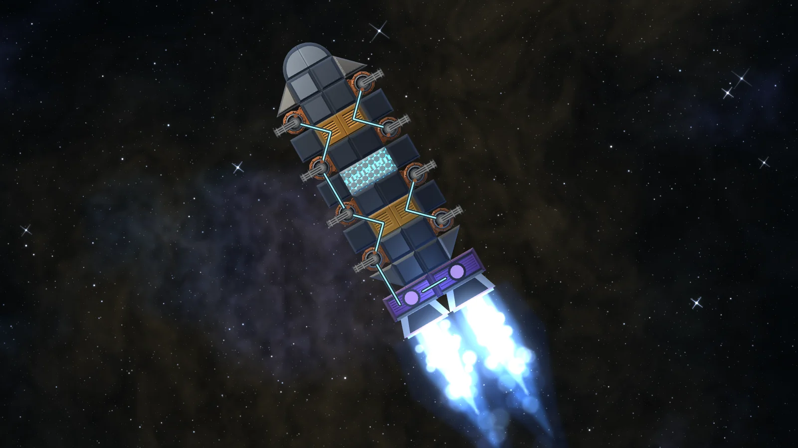
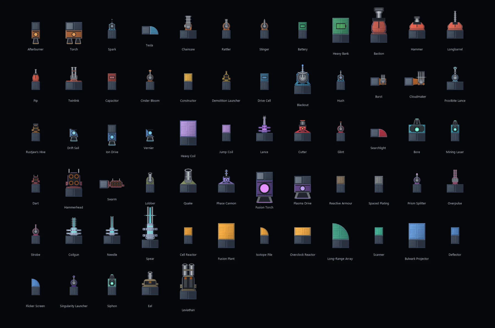

This is the biggest change to ship building so far. The short version: parts have names and personalities now, power travels along wires, and guns care how you mount them. Your old ships come along for the ride.

## Every part is a named model

Components used to be a material crossed with a function crossed with a shape. Now each one is a fixed model with its own size, stats, trade-off and recipe. A few examples from the weapons list:

- **Pip** is the starter gun: light and quick.
- **Hammer** fires a slow, heavy shell that hits more than three times as hard.
- **Twinlink** is a turret that fires in pairs, at the cost of power.
- **Longbarrel** is the sniper's cannon: faster, longer-lived shells, a slower reload.

Engines got the same treatment. Each has a **rated speed**: near full thrust until you get close to it, none past it. The Ion Drive is efficient but tops out early, the Afterburner trades a weak cruise for a huge boost, and the Torch is brutal thrust that eats energy.

Materials haven't gone away. They're still what hull, armour and cargo plates are made of, where they make sense.

## Power runs along wires

Modules no longer share power just by touching. Power travels along **wires**, drawn over the hull from your generators to everything that makes, stores or draws power. A wire works while it's connected end to end; destroy the block under any part of it and it's cut there, and whatever was past the break goes dark.

You don't have to wire by hand. The hangar's **Auto-wire** button lays a sensible network for you, and you can draw or erase segments yourself. Wires cost wire spools (one spool lays four segments), charged when you save a design. Live wires glow in their network's colour; cut ones go dark.

## Guns have mounting rules

Each weapon now says how it can be fitted:

- **Attach edge**: most guns bolt on from the back and need that edge joined to another part.
- **Side mounts**: some (Burst, Cloudmaker, Searchlight, Swarm, Tesla) bolt on at right angles to where they fire. Flip them with F.
- **Turret arcs**: every turret has its own traverse. Lobber and Hush turn all the way round, Overpulse covers 120°.
- **Clear lanes**: long guns need cells in front of them left empty. A Longbarrel wants three, a Lance four.

The hangar shows all of it while you place a part: the attach edge in green, the lane that must stay clear, and the turret's arc. It refuses a placement that breaks a rule and tells you why.

Ships fitted before the rules existed still fly. Their broken guns are marked red in the hangar, with the reason in the tooltip, until you fix them.

## Everything opens at a level

Everything you can make now has an unlock level, and nothing opens earlier. Schematics are retired: their drops and shop stock are gone, and quests that gave them hand out plate or parts instead.

The six boss legendaries open at their level too, but each recipe needs one very rare part from its boss, rolled per pilot per kill. Expect an evening or several of farming for one.

Level-up toasts now name what you just unlocked, and the field guide shows the whole track.

## Your saves are safe

Existing ships, designs and cargo migrate automatically. Each old part becomes the nearest new model, counts are kept, conduit blocks become plain hull, and old ships are auto-wired on load. Nothing you owned is lost.

As always, tell us what feels off on the [suggestions board](/suggestions).
