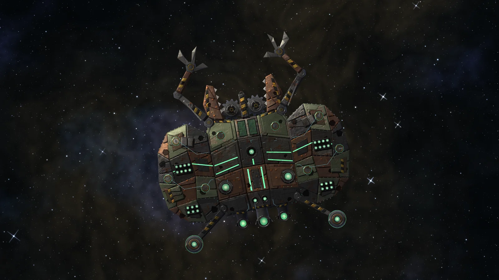

There's a new boss in Sol, and she's big. The Scrap Mother waits inside her own nest: a pocket of space reached from the Drift, a thick field of rock and junk round an open hollow, with a lane running in from the south.

She's built like every staged boss should be, and the guide we wrote while making her will shape the ones that follow:

- **Three stages, each its own fight**, not the same boss with less health. Each has its own moves, its own way of moving, and a pattern to learn.
- **Every attack that hurts is warned first**, showing where and when.
- **Moves come in a fixed order** per stage, so you can learn it.
- **Parts matter.** Shoot a weapon part off and that move stops.

Here's what to expect, without spoiling every trick.

## Stage one: the hoard

Her nest wings, crane arms and grapple booms. She hangs back and lets her guns work.

- **Barrage**: her wing guns fire in turn, clockwise. Each draws a yellow line, then hammers rivets down it.
- **Haul**: her electromagnets wind up (green rings closing on her), then drag you in while her claws snap shut ahead of her. Thrust away, or get out of her front. Shoot a magnet off for less pull; take both claws and there's no snap.
- **Brood**: her egg racks hatch scrap mites that hunt you down and burst. Shoot the racks off and there are no more.

## Stage two: the mill

Lighter now, she drives harder and closes in.

- **Intake**: she turns her maw on you, draws a green lane, then sucks you towards her grinding rotors. Wreck the throat and she can't pull; wreck the rotors and she can't grind.
- **Slag**: her vats lob sludge where you are and where you're heading. It pools and burns for a while.
- **Shrapnel**: rings of great scrap chunks, two gaps in each, turning as they come.
- **Charge**: keep your distance too long and she'll line up and ram. Once spent, she drifts.

## Stage three: the seed

Small and quick, darting to a new angle before every move.

- **Scissor**: two arc welders draw lines wide on either side, then sweep their beams in until they cross ahead of her. Get between them close in, or well out to the side.
- **Seekers** from her greyseam spikes, and **spirals** of scrap spun out of her core.
- **Iris**: her iris opens (a breathing green ring) and throws rings of chunks. It's the only time she takes full damage. The rest of the time she's braced and your hits glance off, unless you've shot her spikes away and she can't brace at all.

> "Something huge and patched together stirs in the hollow at the heart of the junk, grey veins glinting in the rock around it."

That's how the game opens the fight as you arrive. She's tuned for pilots around **level 8**, comes back ten minutes after she falls, and drops servo motors, power couplings, scrap electronics, alloy plate and repair kits.

Bring friends. Tell us how it went in the [shoutbox](/#shout-h).
