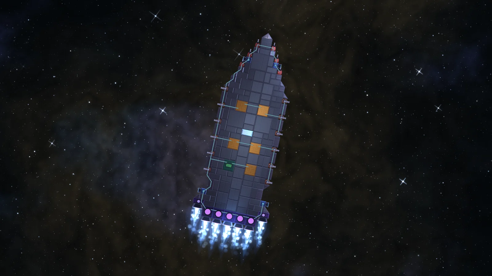

Three smaller things that make the game nicer to play, and one that made this website possible.

## Helm mode

Mouse steering is still the default, but you can now take the helm. Press **V** (or pick it in Settings):

- **A** and **D** turn the ship,
- **W** and **S** thrust along the nose,
- **Q** and **E** strafe,

and the view swings round so your nose always points up the screen. The camera eases onto your heading, never whipping round faster than a gentle turn, and name tags and damage numbers stay upright. Switch back any time and it eases back to north-up.

## The Component Guide

Press **C**, or open it from the Escape menu. It lists every component you can build, by tab, sorted by the level it unlocks at. Each row shows:

- its level, picture and name,
- what still stands in your way (a level, a licence or a rare boss part),
- and what it takes to make, in red where you're short.

Open a row for its full numbers, how it mounts, its trade-off, and where its rare part drops.

## Pictures straight from the game

This one is a developer tool, but you've already seen its work: every ship and boss picture on this site comes from it. An asset viewer and a command-line renderer draw any ship, boss or part with the game's own shaders (hull, lighting, turrets, wires, engine flames, sky and bloom), so patch notes can show the real thing.

Have an idea for the next round of quality-of-life fixes? The [suggestions board](/suggestions) is open.
