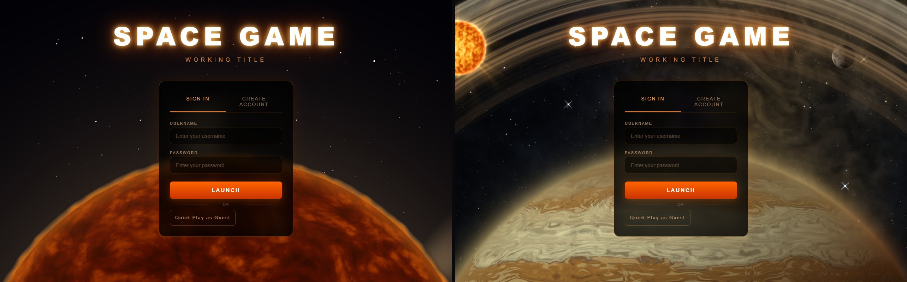
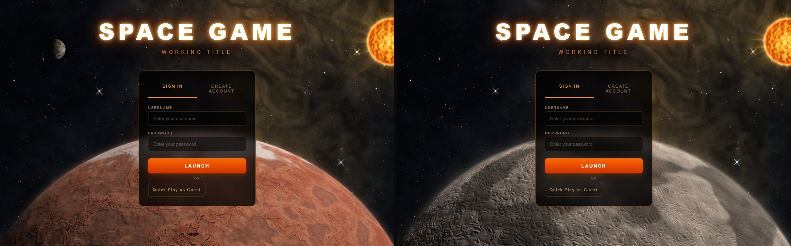
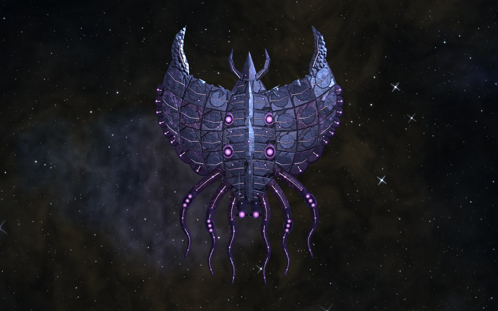

Four graphics changes. The sign-in screen and the Citadel have before and after pictures, with the old look on the left and the new look on the right. The asteroids and the Brood Mother are new, so they have an after picture only.

## The sign-in screen

*Before / after.* Before, the screen showed the game's sun at the bottom, behind the sign-in box, on a plain dark sky. After, it shows a body from the Sol system in the same place. Here it is Jovan with its rings, with Sol's own sky and nebula behind it, a small moon and a small copy of the sun in the upper corners, the sun as the light source. The sun is still the background about one visit in six. The sign-in screen takes about the same time to appear as before.

*New, no before picture.* The background is picked at random on each visit. These two are Ares, a red planet with cracked ground, and Vesta, a grey cratered world. The old screen always showed the sun, so it has no matching before picture for these.

## The Citadel

*Before / after.* The labels on this picture ("today" and "new") were drawn when it was made. The top row shows the whole station. Before, the rings are evenly lit and a red glow marks each of the four arm tips. After, the rings are lit from one side with highlights and shadow, and the arm tips are small points of light. The solar panels are darker blue.

The bottom row shows the hub up close. Before, the hub is a pale octagon around a flat dark disc ringed with teal dots. After, the octagon is darker metal edged with a dashed line of white lights, and the centre is a glass dome with ribs and a teal glow inside it.

## Asteroids

*New, no before picture.* This is the set of eighteen asteroid types, each named with its material: stone, ice, crystal, metal, tar and leestone. Each is an angular, cratered rock lit from one side. Stone and metal rocks are brown or grey with a pitted surface, ice rocks are pale blue with thin cracks, crystal rocks are teal and green with glassy facets, tar is black with small bumps, and leestone has fine dark ridges. No earlier picture of the asteroids was kept to compare against.

## The Brood Mother

*New, no before picture.* The Brood Mother is a new boss. She has a wide, curved shell of dark blue plates with glowing violet marks, a spiked head at the front and long tendrils behind. Her look is finished and her fight is still being built.
