So the last few days I've been auditing and redoing a lot of the in-game graphics. The old shaders had become quite inefficient: crap stacked on top of crap to try and get an interesting, detailed look. So I decided to look at them from scratch and upgrade them.

I found I can get a much better result in almost every case, with more detailed and interesting effects, and it turns out it's much cheaper on the graphics card too.

In each picture below the old version is on the left and the new one on the right.

## The suns

| Star | Old (ms a frame) | New (ms a frame) | Cheaper by |
|---|---|---|---|
| Sol | 0.19 | 0.048 | about 4× |
| Nebula Prime | 0.39 | 0.042 | about 9× |
| Borealis | 0.49 | 0.036 | about 13× |

*Measured at 1080p, at each star's edge. At 4K the old sun cost 0.8 to 2.2 ms a frame and the new one 0.13 to 0.29 ms.*

As you can see, the old sun was far more expensive, and looked far worse. Even with a half-scale shader (which is almost indistinguishable from the full-size one for this) the new effect is better, and somewhere between about 4 and 13 times less expensive depending on the star and your zoom level.

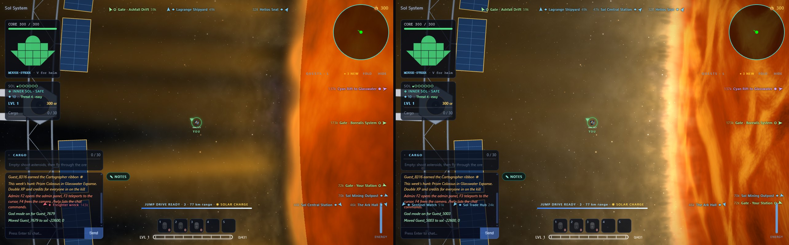

Sol used to be a smooth orange disc with a soft blur at the edge. Now it's a moving plasma surface with fine bright filaments and dark gaps, and a ragged edge that glows out into the sky.

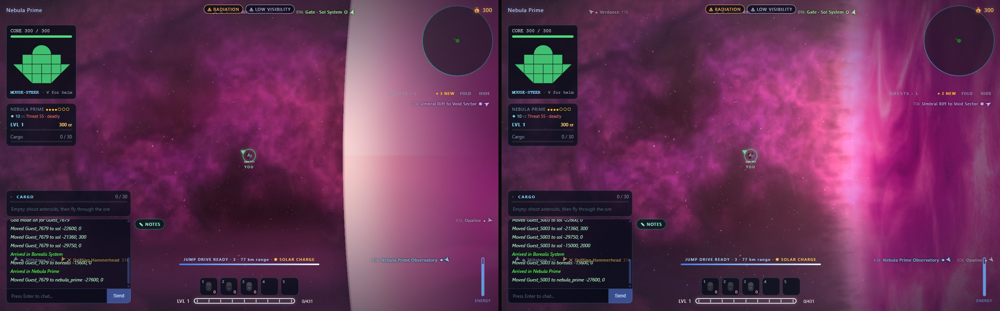

Nebula Prime's star had a hard pink edge with a band running across it. Its edge now breaks up into pink and white plasma that fades into the nebula behind.

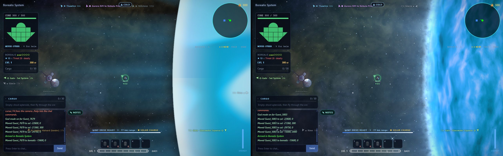

Borealis went from a flat pale disc, with a visible seam near the top, to a deep blue star with turbulent streaks across it.

The stars in the background had a bit of optimisation too. They're now drawn as sprites in a single pass, which took the sky from 0.22 to 0.023 ms a frame, about ten times cheaper. They look slightly better, but it's not a huge change. If a sun fills the whole screen, the sky behind it isn't drawn at all.

## The planets

Besides that, I also updated the planets. Each one is now a lit sphere with its own surface detail, an atmosphere or a heat glow at the edge, and shading that follows where its star is. Far out they cost about the same as before; up close they're up to about three times cheaper. A gas giant's surface up close went from 0.23 to 0.08 ms a frame, and at 4K Jovan's edge went from 0.74 to 0.27 ms.

The planets move along their orbits, so the old and new shots aren't framed exactly the same.

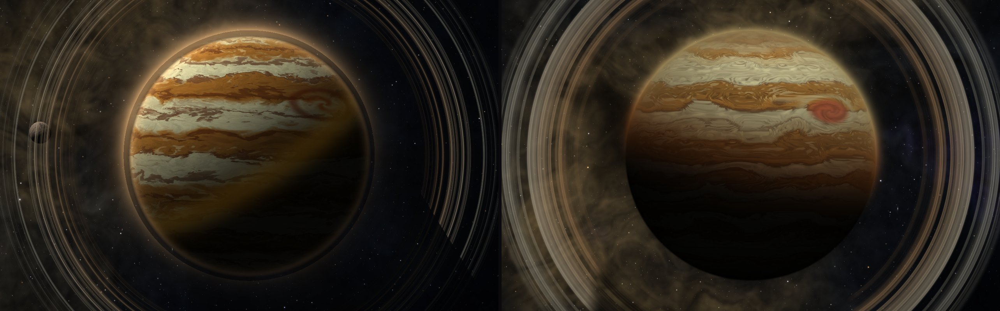

Jovan used to have wide, flat bands and thin, faint rings. Now its bands fold and flow like clouds, there's a great red storm on its side, and the rings are wider and see-through.

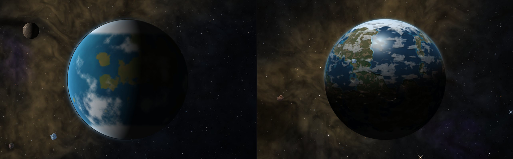

Terra Nova had flat green patches on blue and a hard line where night begins. It now has proper coastlines, ice at the pole, drifting clouds and a soft twilight edge.

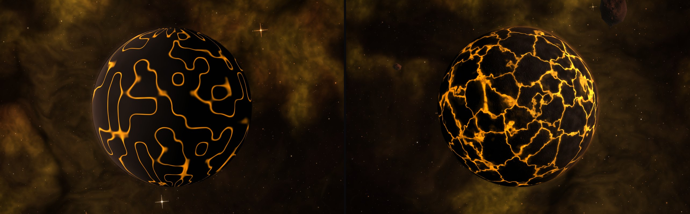

The lava worlds went from a dark ball with orange contour lines to plates of dark crust with glowing rivers running through the cracks.

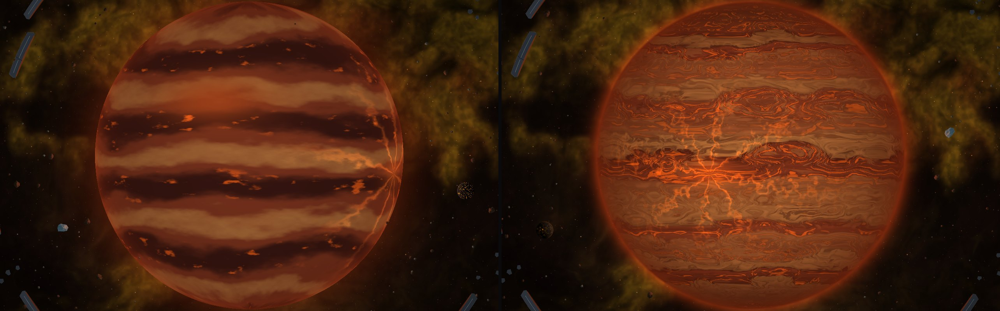

The brown dwarf's stripes now break up into swirls and eddies, and the whole thing glows with its own heat.

## The sign-in screen

I also updated the sign-in screen to show a random selection of celestial bodies from Sol, with the new sun off in the corner as the light. The sun itself still turns up about one visit in six. It loads in about the same time as before.

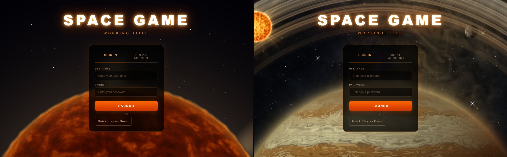

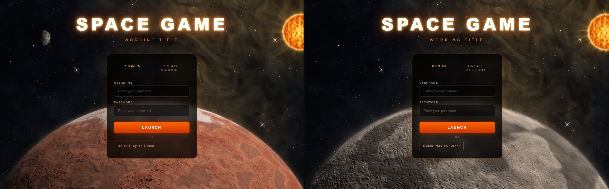

## Everything else

The Citadel station got a new look as well. Its rings are now lit from one side, with highlights and shadow, instead of being evenly lit all over. The hub in the middle is a glass dome edged with lights, where it used to be a flat disc.

The asteroids now come in eighteen types across six materials: stone, ice, crystal, metal, tar and leestone. Each one has its own look, so you can tell at a glance what you're about to mine. There's no old picture to compare against for this one.

I've also added some bosses: the Pyreclast, the Scrap Mother and the Brood Mother.

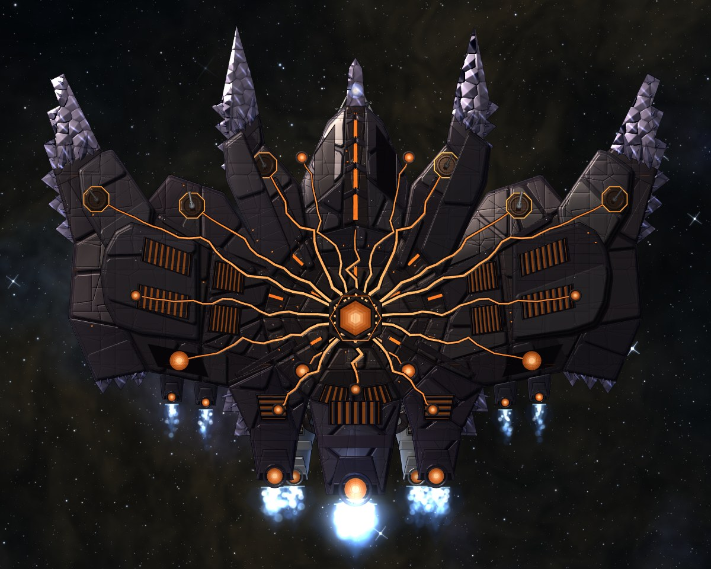

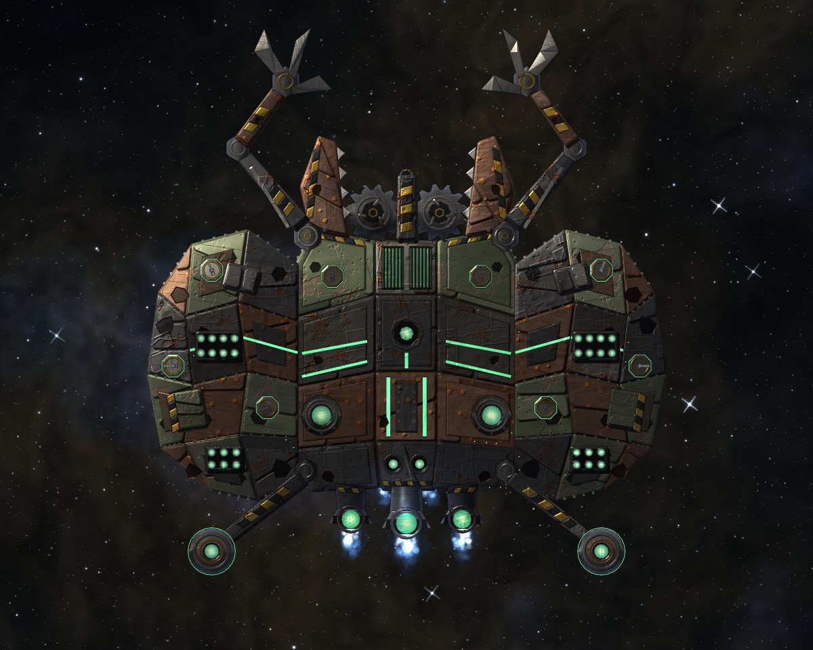

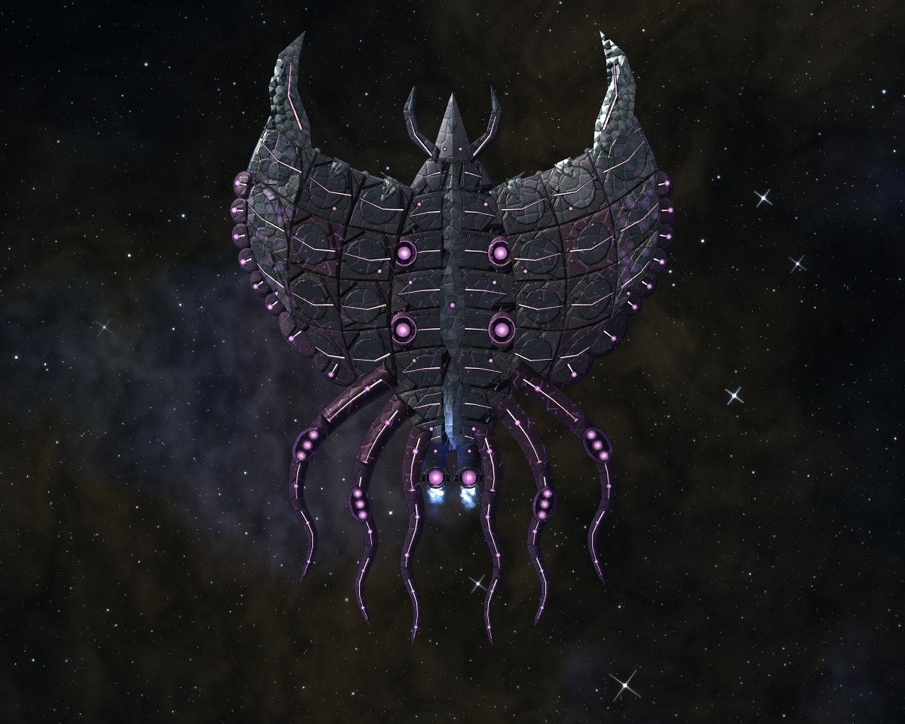

They each break apart, and have three stages, and each stage behaves differently. They haven't really been heavily play tested yet: the foundations are there, but more work has to be done.

This is the Pyreclast. You break through its carapace, then the complete outer shell, then you fight a stripped metal chassis, then the core itself.

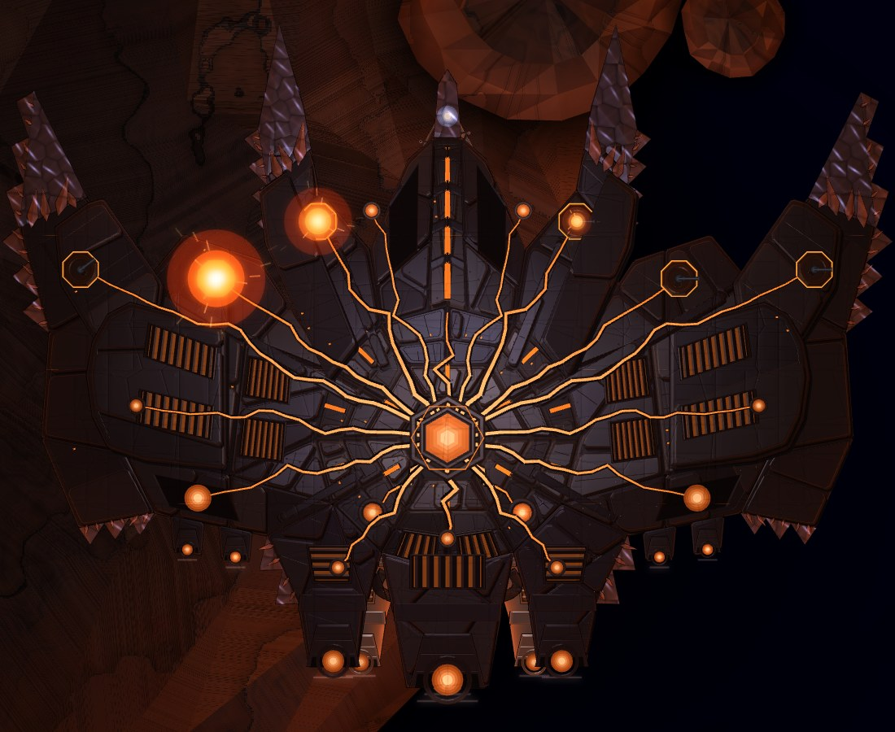

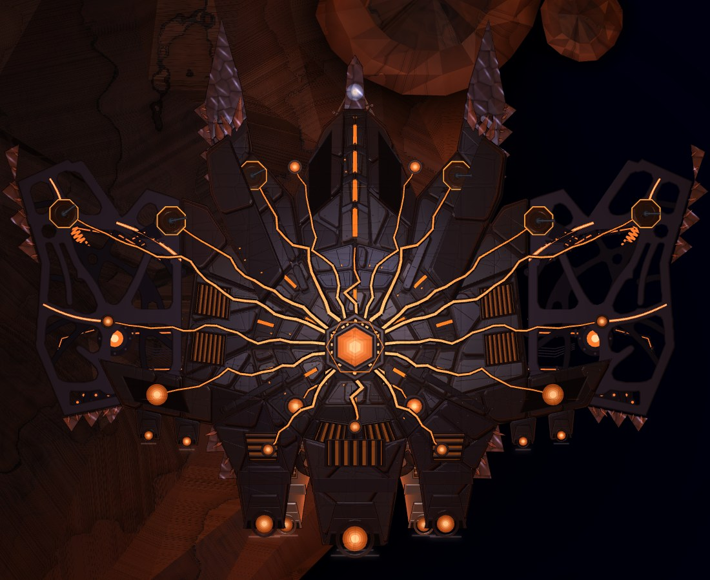

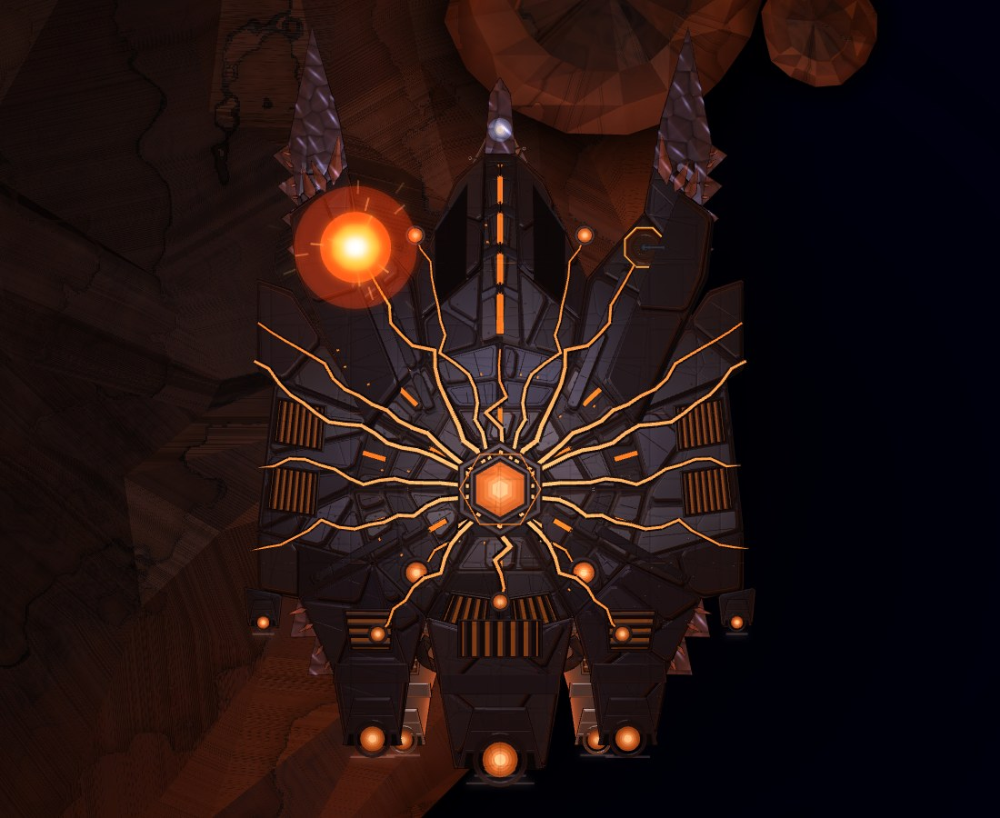

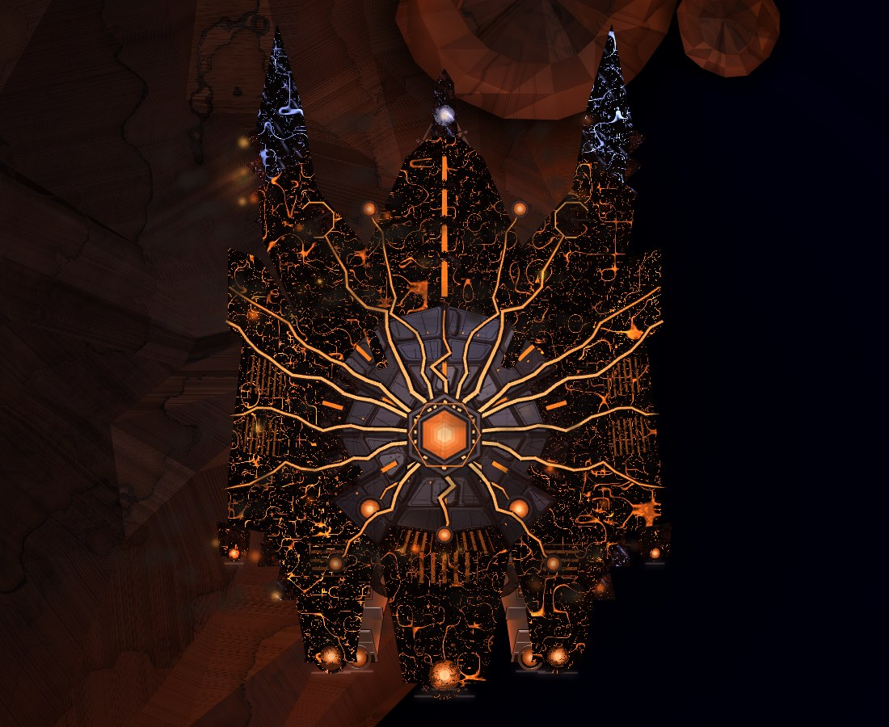

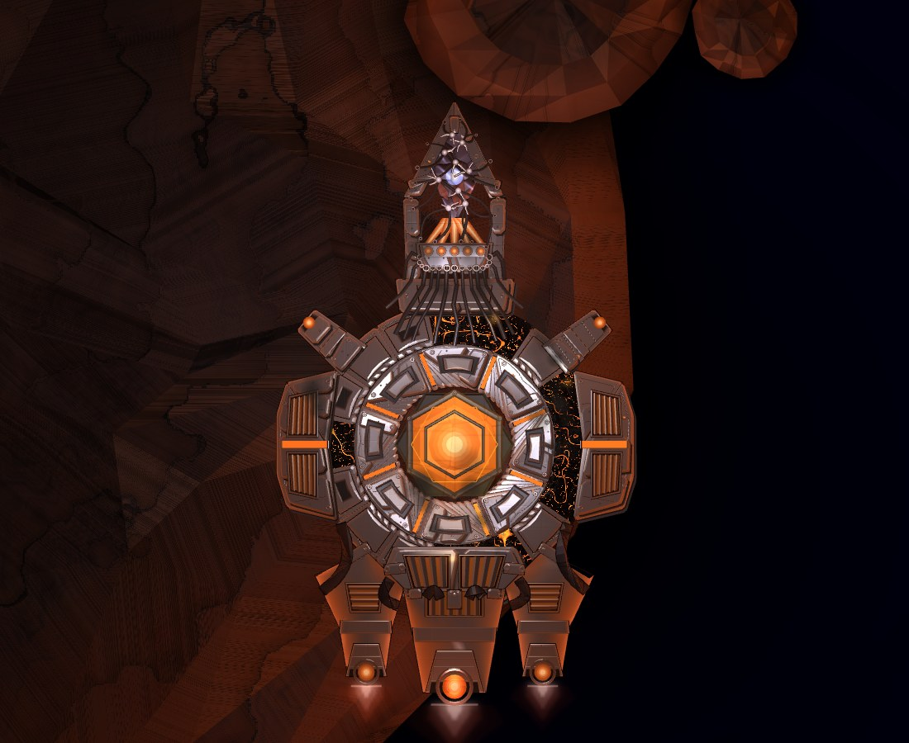
