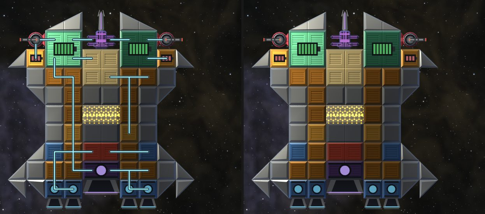
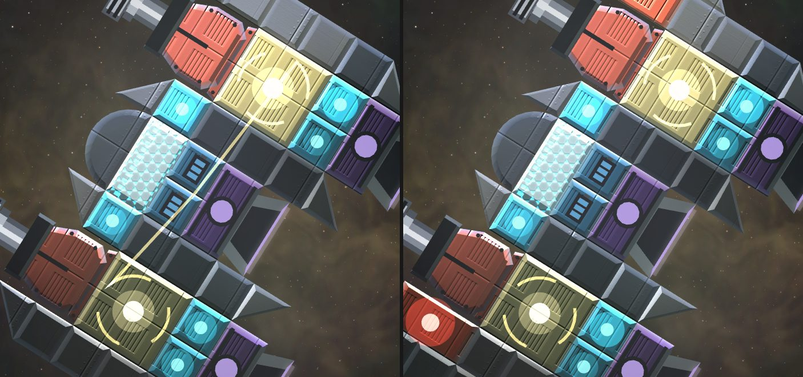
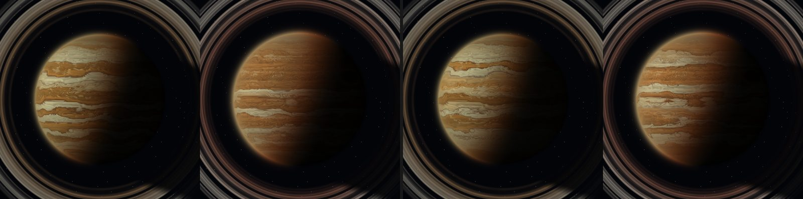
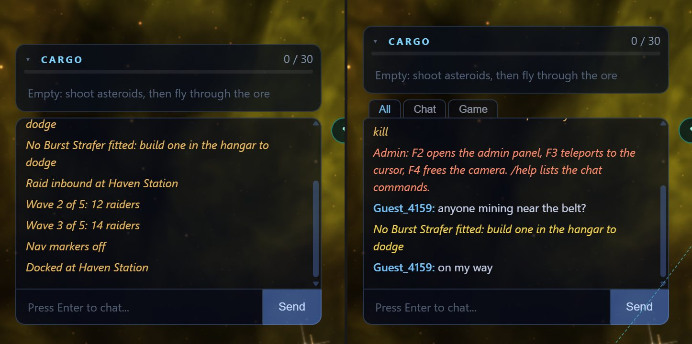

So since the last post I've been working through the ships themselves: how the engines and parts look, what you see when you shoot something, and how much data the game has to push around while you do it. A lot of it is small on its own, but it adds up to the game feeling quite different to fly.

None of this is on the live server yet. It all ships in one go once the dev version is in a state I'm happy with, so this is a look at where things are heading.

In each picture below the old version is on the left and the new one on the right, same as last time. Where there's nothing to compare against, I say so.

## Ships and parts

### Engines

Every engine used to share a flame with the rest of its family, and the default one was blue. Now each model has its own: a steady narrow column for the Ion Drive, crisp puffs for the Vernier, a roaring orange cone for the Afterburner that flares out long when you boost, a white-yellow needle for the Torch, a magenta stream with rings travelling down it for the Plasma Drive, and a narrow blinding core in a violet sheath with a long trail for the Fusion Torch. The Drift Sail doesn't have a flame at all, just a sheet of light with ripples rolling through it. The Burst Strafer only shows its sideways gas pops when you dodge.

The reason is that the flame is the first thing you see of another ship, and it's the quickest way to tell what it's flying with. If two ships have the same hull but different engines, you can now see it from across the screen.

### Plating, power parts and guns

The plating got a pass too. Spaced Plating is now ribbed, layered plates with dark gaps between them, and Reactive Armour is tiled bricks, each row offset from the last. The four reactors now have their own colours and the Capacitor is amber, so you can pick them out of a crowded hangar. Those colours don't show up well in a still picture, so there's no comparison for them here.

Guns are real models now. Before, a gun was a red block with a barrel stuck on top. Now each one sits on its own mounting base, and the cannons are each a different shape that you can tell apart at a glance.

Fixed guns also point where they aim now. A fixed gun can swing a little inside its gimbal, and before, the barrel stayed drawn straight while the shot went off at an angle. Now the barrel toes in to match. The Lance swings the furthest, 13.5 degrees, and the Anvil's cannons turn by their 2 degrees, which you can barely see.

### Wires are gone

I've retired wiring. Power will flow between touching parts instead of along lines you draw. The renderer used to draw wire runs over ships, and now there are no wire lines anywhere: not in flight, not in the stills, and not on the hangar grid. The hangar's Wires tool is gone and saving a ship no longer costs wire spools.

Some of the pictures in this post were taken before I took the wires out, so you'll still see wire runs in a few of them.

### Reading your ship on the HUD

The ship panel at the top left now does more of the work. The little schematic is the readout: each part is tinted by its health, stores show a liquid level, guns fill as they reload or charge and flash when they fire, thrust and lit beams glow, and a part that is short of power pulses red round its outline. Plain hull recedes so the working parts stand out, and hovering shows what each one means. It updates 10 times a second.

Underneath the core bar there are now shield and energy bars as well, and a details box beside the panel (it folds with the arrow). It shows the energy stored, generation against draw, each store's bar, the shield, hull integrity, each weapon's state with a progress bar, and thrust and boost.

### Your shield

Your own shield used to be a filled glowing bubble over the whole hull, all the time. Now at rest it's only a thin rim. The filled bubble comes up briefly when you're hit, or while the shield recharges. The rim is at 60% by default, and you can change that under Settings, Display, "Your shield at rest".

## Hits and weapons

### Impacts scale with the gun

Before, a hit from a heavy gun was a slightly bigger spark that was gone in about a quarter of a second, much like a Pip's. That never felt right, since a Bastion shell and a Pip bullet are not the same event.

Now the size and length of an impact rise with the damage the shot does. The Pip stays a quick flick, and the Spark lasts about half a second. The Hammer, Rail Driver, Longbarrel, Spear and Bastion throw a fireball off the hull and 7 to 18 glowing fragments that slow, cool and trail smoke for one to two seconds. Heavy guns get the full layered hit, mid guns a smaller core and a thin ring, and simple guns a small quick spark.

The fragments also changed. Before, they drifted out slowly and hung around the hit. Now they burst out of the fireball about two and a half times as fast, and the typical one is gone in a bit over half its old life. About one in six is an outlier, much faster or longer lived, so a heavy hit doesn't look the same every time.

Hits now throw off the surface they hit. The game finds the struck edge of the part or rock along the shell's line (this costs nothing on the network, it's worked out on your machine), and slugs and rails glance off it. The Rail Driver, Longbarrel and Bastion also throw a streak of the shell itself, and bolts of light splash straight out. The rebound leads now: bright streaks shoot out along the line it bounced, three fanned off the Bastion, followed by a denser spray. The core and glow are a small brief pinpoint, and the shock rings are gone.

And they stay attached. Before, the fireball and sparks stayed where the hit happened while the target flew on, so they slid off it within a tenth of a second. Now the fireball, glow, scorch and light ride the hull or the rock as it moves and turns. The fragments leave with the target's velocity and trail along behind it.

### Bastion

The Bastion's hit changed the most. It was two flat discs up to about 300 units across and a red light over the whole screen. It's now a white-hot core, a red-orange glow, a double shock ring, a spray back off the hull, cooling embers, and a glow on the hull where it struck. The muzzle flash is smaller and narrower, in proportion to the ship.

### Lance

The Lance's part is an armoured shroud with the core glowing through its slots, a faceted spar through two collars, a crystal between two prongs, capacitor cells down the cradle and lit bulbs on its saddles. Before it was a slim grey spike on a purple cradle.

The beam was a violet tube wound with a white zigzag that just stopped and started. It's now layered (soft haze, violet sheath, lilac body, white core) with crackling edges and energy running along it, a flare and sparks where it lands, and a burn that rides the hull and cools. When it goes out the beam runs off down the line instead of vanishing, and it now starts at the tip of the barrel.

Between bursts the muzzle shows what the weapon is doing: a swelling orb and a tightening ring while the buffer fills, a slow ring when it's full, and a flash and shock ring as it lights.

### Spark

The Spark's shot used to be a line from the barrel that grew out and vanished. It's now a blue bolt with a hot head that leaves the barrel and flies out to its reach, with a short wake behind it.

I also gave it a lot more range. The old bolt was short, with a reach of 660. Now it's a long streak, about 1,100 long (the longest tracer of any gun), and it flies out to a reach of about 3,960. To pay for that I took its damage down by 15%, from 34 to about 29 a bolt. Before, other pilots only saw it for the first one or two ticks out of the barrel (110 to 190 of its 660) before it faded, so there's no picture of how it looked to them. Now they see it fly its whole length.

### Cutter

The Cutter's burn had only a molten pool and a few sparks round the burn point. Now, every few frames, sparks and a streak splash out of the hull, and glowing chips tear off and trail smoke for about a second. There's no old picture to compare, so this one is the new version only, at 3, 10, 30 and 60 frames into the burn, then half a second and a second after it stops.

### Two fixes

The Fusion Plant's turning ring was drawing a stray line to the other plant on the ship. Each arc now starts at its own end.

The gas giants had a flicker. The band tints came from a hash that was being fed numbers of about 27,000, and at that size it now and then flipped whole bands to the other tint for a single frame. I swapped it for a hash that doesn't use sin. On a gas giant sitting still, the old one flickered 23 times in 16,800 frames, and the new one once in 14,400. The side effect is that each planet's band pattern is different now, with the same palette and a mix of pale zones and dark belts. This is Jovan and Cinderjack.

## Terra Nova

Terra Nova got reworked. The continents are the same, but the land now has climate: rainforest, temperate green, a dry subtropical belt, boreal forest and tundra, with mountain ranges and snowy peaks. The sea runs from deep ocean through lighter shelves to turquoise shallows. The polar caps are smaller and come with sea ice. Clouds come in climate bands and wind round cyclones, and you can see town lights on the night side.

After a look at it in the game I retuned it. The water was much shinier than the land, and the land was dark. The sun glint is now a smaller, softer highlight that doesn't show through thick cloud, the land is brighter and takes the light more softly, and the sea has broad faint colour swathes with green plankton blooms offshore.

It costs a bit more than the old one to draw, which is the trade for the extra detail. These are in milliseconds a frame at 1080p on the Medium setting:

| View | Old | Now |
|---|---|---|
| Sign-in screen size | 0.074 | 0.095 |
| Whole planet (600 px across) | 0.029 | 0.029 |
| Close, on the surface (zoom 2) | 0.074 | 0.132 |

*The whole-planet figure was measured at the rework and hasn't been re-measured since the retune.*

## The sign-in screen

The small sun and the small planet or moon on the sign-in screen now orbit the big central body together, at the same slow pace. A full turn takes an hour, and each one moves on its own ellipse. So the light on the central body follows the sun across the sky, and when the small body leaves at the far edge another of Sol's bodies, Terra Nova for one, comes in. If you've got reduced motion on, everything stays still like it did before. It makes no real difference to load time: the screen was ready in 406 to 437 ms with the orbit and 413 to 421 ms without it.

The orbiting sun used to be drawn over the central body. It's drawn first now, under the central body, so the disc, haze and rings cover it and it sets behind the limb.

Here's the new Terra Nova on the real sign-in screen, as the central body.

## Joining and arriving

Joining the game now shows a loading screen ("Connecting", "Receiving the world", "Syncing with the server", "Catching up", "Building the sector") until the world is in sync, and then it fades out. Before, a few things went wrong while it loaded: the camera slid onto your ship from off to one side, rocks drew at the wrong place in their orbits for two seconds and then jumped, and a "+300 credits" popped up for credits you already had.

The first reply from the server used to come in 2.0 seconds after picking the server. It now comes in at about 0.1 seconds, and the camera is on your ship from the first frame. The screen lifts after 0.8 to 2.6 seconds, mostly waiting on the rock relief atlas and the lodestone maps from the worker. Those figures were measured headless on a busy machine.

Arriving in another system, or respawning, uses the same screen briefly ("Arriving" or "Respawning" with the system name) while the new world comes in. It's up for about 0.37 seconds on arrival and 0.27 seconds on respawn, and the camera is already on your ship when it lifts. Before, the camera started 604 units off the ship and took about a second to slide on.

## Chat

The chat window now has three tabs: All, Chat and Game. Game lines fold repeats into one (×3). Raid starts, siege waves and boss sightings don't go to the chat any more, since the toast already shows them, and the nav markers and docked notices are gone too. The idea is that there's less system noise between what other pilots are saying.

## The network

The last part is the least visible, and it's probably the part that matters most for how the game plays online. I measured how much the game has to send you during a fight, before and after the changes. The measurements use a real game server with fake clients in the same seeded world, 20 seconds each, and count the bytes a pilot receives a second (the number the ping panel shows).

The changes were:

- A plain slug no longer sends a detonation. Your game draws the impact from the hit itself.
- Effects only go to pilots within 48 km, and removals only to the pilots who had the thing.
- Damage is summed per target and source and sent as one number, instead of one for each hit.
- Ships ignore debris, and debris is worked out by your own game rather than sent piece by piece. The server sends about 20 bytes when a ship splits, and your game works out where the pieces go with the same rules. That took debris traffic down about 88%.
- A pilot's hits can now be sent as a short record ("shell s hit part p of ship t"), and the game works out the damage, part health, fire and effects itself using the same shared rules. The server checks what each client works out. This is the newest part, and it only applies to a game that supports it.
- The hot messages (fires, detonations, pings, boss telegraphs) moved to a more compact format.

What you receive, in bytes a second while you're the one shooting at a parked freighter:

| Fight | Before | After the first fixes and compact messages | With hits sent as records |
|---|---|---|---|
| 2 Pips | 1,236 | 835 | 639 |
| Hammerhead (12 Rattlers and 6 Pips) | 5,017 | 2,905 | 2,362 |
| 2 Sparks and 2 Chainsaws | 5,974 | 3,567 | 2,387 |
| 5 to 7 pirates (Corsair) | 1,228 | 1,202 | 1,187 |
| Scrap Mother (Hammerhead) | 5,332 | 5,061 | 4,974 |

Fights with slug guns and a lot of hits get the most out of it, which is why the Pips, Hammerhead and Sparks move and the pirate fight barely does. The boss fight isn't a like-for-like comparison, because ships pass through debris now and the fight plays out a bit differently.

Those figures are the payload. Every message also pays about 66 bytes of headers on the wire, and the number of messages didn't change. So on the real connection the saving from sending hits as records is smaller than the table suggests: about 10% for the 2 Pips, 13% for the Hammerhead and 24% for the Sparks fight.

The bigger win is for everybody else in the system. If you're in the same system as a fight but 60 km away, you used to be sent most of it. Now you aren't:

| Fight, seen from 60 km away | Before | Now |
|---|---|---|
| Hammerhead | 2,192 | 448 |
| 2 Sparks and 2 Chainsaws | 3,249 | 570 |
| 4 freighters broken up close together | 2,351 | 623 |
| 2 Pips on a moving freighter | 412 | 38 |

Two things you'll see in play from all this. Slug hits no longer shake the screen: before, about 8 hits a second from two Pips (or about 40 from a Hammerhead) each shook the camera as a missile would, which averaged out to about 17 to 21 pixels of shake while you were firing. Now there's none. And damage numbers show as one per target and source every 50 milliseconds rather than one per hit, and ships no longer bump into debris.

There was one thing that got worse. With fewer bytes in the small fights, a lot of the messages dropped under the size where the connection compresses them, so for two Pips the compressed total went up slightly, 646 to 793 bytes a second, even though the raw number went down. Lowering that threshold is a one-line change that I still need to measure.

## What's next

Mostly more of the same: play testing all of the above, and fixing what turns up. I'll add more pictures here as things change.
