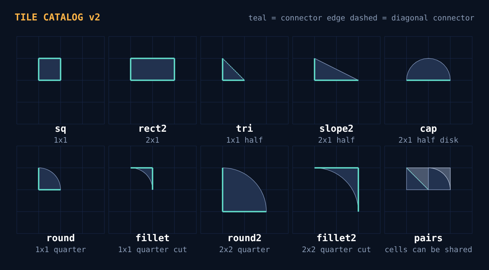
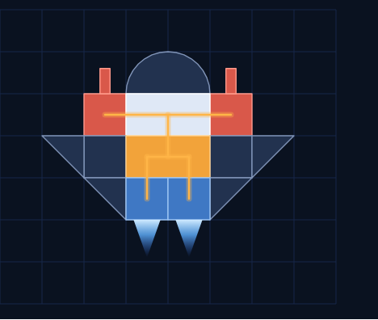
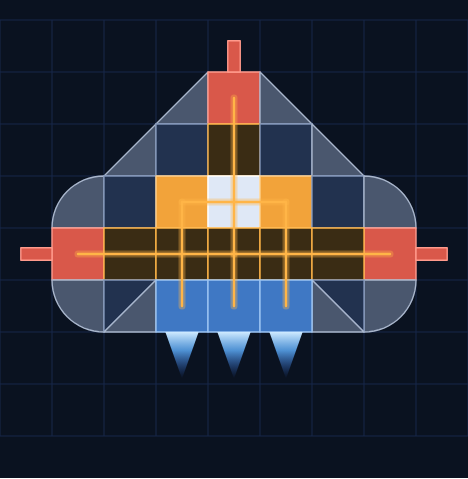
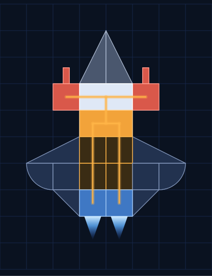
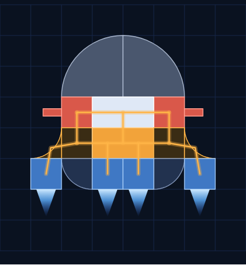

# Modular Ship Prototype Spec v2

Spec for a coding agent. Version of 2026-10-19. The images referenced here are in `images/` next to this file. Each one is a PNG with an SVG source.

## Goal and scope

Prototype the modular ship system inside a copy of the live game, running in one process with networking left out. The work is the ships and only the ships. The prototype runs in a bare, empty space: no sector, no sun and no asteroids, just a background, the ship and test dummies. The game's camera, controls, HUD and admin panel are reused as they are. Every ship module is written so it can later be moved into the networked game without being rewritten.

**Build**

- A tile-grid ship model: square cells as the base, plus triangle and curved pieces that fit the same grid
- A catalog of predefined tile pieces. Players collect and craft these, and assemble them in any layout
- A hangar grid editor for assembling ships
- A structure graph, power flow and derived flight physics, replacing the current triangle ship
- Per-part damage, detachment and debris
- Weapons firing the existing base shot, with a hook point for the later modifier system

**Don't build**

- Networking, multiplayer, persistence on the server, or any other new game systems
- The roguelike modifier system beyond its hook point (see the shot section)
- The mining and crafting economy. Inventory is a stubbed list

## Prototype environment

The prototype is a branch of the live game repository (`proto/modular-ships`). It isn't a fresh project, so the ships use the real engine loop, camera, controls and feel. Proto mode loads an empty scene instead of a sector: add a scene that spawns only the player ship, and skip the sector loader's sun, asteroid belt and mining entities.

**Step 0: map the engine before writing any code.** Read the repository and write `docs/engine-map.md`, which answers these questions with file paths:

- Where is the ship entity defined, and where are its hardcoded stats (speed, turn rate, HP, fire rate)?
- Where do the server tick and the client frame loop run, and at what rate?
- How does player input get from the keyboard to the simulation?
- How are entities rendered, and how is collision tested?
- Which code is shared between the client and the server, and which is client-only or server-only?
- What does the network layer send for a ship today?

**Single-process mode.** Add a launch mode, `npm run proto`, that runs the authoritative server simulation and the client in the same browser process. The client hands its input objects to the simulation through a `LocalTransport` that implements the same interface the socket transport does, synchronously and with zero latency. Client prediction and reconciliation are switched off in this mode, because the client reads the simulation state directly. Nothing in the ship code knows which transport is in use.

**Integration rules** (these are what keep the later merge cheap)

- All ship logic lives in one new folder inside the existing shared code, for example `shared/ships/`. It must not import anything from the client, the renderer, the DOM or the network layer.
- Ship logic is deterministic. Use no `Math.random()` (take a seeded RNG instead) and no wall-clock time (use the tick number).
- It runs on the game's existing server tick rate. Don't add a second loop.
- All ship state that changes during play is plain serialisable data, so it can be snapshotted, diffed and later sent over the network.
- The old triangle ship stays selectable behind a flag (`ships.legacy = true`), so you can compare the two side by side.
- Client-only code (hangar UI, ship rendering, debug overlays) goes in a separate `client/ships/` folder.
- Keep changes to existing files small and list each one in `docs/engine-map.md`, so the merge back is easy to review.

**Language:** use whatever the game is written in. The interfaces in this doc are TypeScript for clarity.

## Tile grid geometry

Ships are built on a square grid. Every piece sits at an integer cell position, in one of 4 rotations, optionally mirrored. Squares fill whole cells. Triangles and curves fill part of a cell, and are cut so that their straight edges always fall on cell boundaries or on a cell's diagonal. This keeps assembly as simple as placing tiles, while still letting ships have sloped and rounded silhouettes.

**Grid.** One cell is `tuning.cellSize` world units. Start with the size that makes the Sparrow T starter ship about as big on screen as the current triangle ship. The y axis points the same way as the engine's. A ship's forward direction is -y in grid space (up in the hangar), and it is rotated to the ship's heading in the world.

**Piece shape.** Each piece in the catalog has:

- `cells`: its footprint, a list of `[dx, dy]` offsets from its origin cell. Single-cell pieces have `[[0,0]]`.
- `outline`: the exact boundary in cell units. It is a list of segments, where each segment is either a line between two points or an arc given by a centre, a radius and start and end angles. Arcs only ever have their centre on a grid corner and a whole-number radius.
- `connectors`: the places where it can join a neighbour. Each connector is either a cell edge `{cell:[dx,dy], side:'N'|'E'|'S'|'W'}` or a diagonal `{cell:[dx,dy], diag:'NE'|'NW'}`. Only straight, full-length edges can be connectors. Curved faces and partial edges never are.

**Joining.** Two placed pieces are joined when one has a connector on the same cell edge as the other, from opposite sides (or, for a diagonal, on the same diagonal of the same cell). The joins are worked out from the grid after every edit, so a blueprint never stores them.

**Sharing a cell.** A cell can hold two pieces when their shapes don't overlap: two triangles split along a diagonal, or a quarter-round and its matching fillet. Triangles that share a cell join through their diagonal connector, so two materials or two functions can meet along a 45° seam.

**Overlap test.** Use exact geometry, not cell occupancy. Turn arcs into polylines (8 segments per quarter circle), split concave outlines into convex pieces, shrink each piece by 0.01 cells, and test with SAT against the other pieces in the same or neighbouring cells. Because pieces only overlap when they are in the same or touching cells, this stays cheap.

**Rotation and mirroring** map cells, outline and connectors through the 8 symmetries of the square. Precompute all 8 variants of every piece when the catalog loads, then work only with the variants.

**Geometry gives the stats:** mass is `area × material.density`, HP is `area × material.toughness × fn.hpScale`, and inertia comes from the outline's second moment of area. Compute all of these once per variant when the catalog loads.

## Starter tile catalog

The first catalog has nine pieces. Squares and rectangles do most of the work. Triangles and slopes give 45° and roughly 27° edges, and the curved pieces come as matched pairs: each round has a fillet that completes it to a full square, so curves can be added or cut out anywhere.



| Piece | Footprint | Area (cells) | Connectors (unrotated) |
| --- | --- | --- | --- |
| `sq` | 1×1 | 1 | All 4 edges |
| `rect2` | 2×1 | 2 | All 6 unit edges |
| `tri` | 1×1, half on a diagonal | 0.5 | 2 legs, plus the diagonal |
| `slope2` | 2×1, legs 2 and 1 | 1 | Long leg (2 edges), short leg (1 edge) |
| `cap` | 2×1 half disk, radius 1 | 1.571 | Flat side (2 edges) |
| `round` | 1×1 quarter disk, radius 1 | 0.785 | 2 straight sides |
| `fillet` | 1×1 minus a quarter disk | 0.215 | The 2 full edges away from the curve |
| `round2` | 2×2 quarter disk, radius 2 | 3.142 | 2 straight sides (2 edges each) |
| `fillet2` | 2×2 minus a quarter disk | 0.858 | The 2 full sides away from the curve (2 edges each) |

Catalog rules for adding pieces later:

- Every straight edge lies on a cell boundary or on a cell diagonal.
- Every arc has its centre on a grid corner and a whole-number radius.
- Every connector is a full cell edge or a full diagonal.
- The `tier` field controls where a piece can be found or crafted. It has no effect on geometry.

When the loader finds a piece that breaks these rules, it fails loudly and names the piece.

## Parts, materials and blueprints

A part is one tile piece combined with a function and a material. Players collect and craft pieces, and the function and material decide what each piece does. For example, the same 1×1 triangle can be armour, a generator corner or a thruster.

```ts
// data/ships/pieces.json -> PieceDef (geometry only, see the catalog section)
interface PieceDef { id: string; cells: [number, number][]; outline: Segment[]; connectors: Connector[]; tier: number }

// data/ships/functions.json
interface FunctionDef {
  id: 'core' | 'hull' | 'armor' | 'generator' | 'conduit' | 'thruster' | 'weapon';
  pieces: string[] | '*';            // which pieces may take this function
  hpScale: number;
  carriesFlow: boolean;              // false for hull and armor: they block flow
  produce?: number;                  // per unit of area (generators)
  demand?: number; priority?: 1 | 2 | 3;
  loss?: number;                     // per conduit hop
  thrust?: number;                   // per unit of area, pushes opposite to `facing`
  fireInterval?: number;             // ticks (weapons)
}

// data/ships/materials.json
interface MaterialDef {
  id: string; color: string; density: number; toughness: number;
  traits?: TraitId[];                // carried for the later modifier system, unused for now
}

// a saved ship
interface Blueprint {
  name: string;
  catalogVersion: number;
  parts: PlacedPart[];
}
interface PlacedPart {
  uid: number;                       // 0..255, unique within the blueprint
  piece: string; fn: string; material: string;
  x: number; y: number;              // origin cell
  rot: 0 | 1 | 2 | 3; flip: boolean;
  facing?: 'N' | 'E' | 'S' | 'W';    // thrusters and weapons: the free edge they point out of
}
```

- Each blueprint has exactly one `core`, which is the structural root. The core carries flow.
- Thrusters and weapons must have their `facing` edge free, with nothing attached to it. Thrusters push the ship the other way.
- Blueprint validation: one core, no overlaps, every part reachable from the core, facing edges free, at most 255 parts, and every piece owned in the inventory stub.
- Inventory stub: `inventory.json` lists the owned pieces with their counts and the owned materials. A debug toggle grants everything.
- A blueprint stores only grid positions, so it is small and easy to diff. Joins are always worked out again from the grid.

## Rebuild: structure, flow and physics

`rebuild(ship)` is a pure function in `shared/ships/`. It runs when a ship spawns, and again when the ship's `dirty` flag is set. The flag is set when a part is destroyed or when a part's HP crosses a 25% band. `rebuild` never runs on every tick.

1. **Joins.** From the grid, list every pair of parts joined by a connector.
2. **Structure.** Flood fill from the core across the joins. Any part it doesn't reach is detached (see the next section).
3. **Flow network.** Keep only the joins where both parts have `carriesFlow`.
4. **Flow solve.** For each connected network, supply is the sum over its generators of `produce × area × health(hp)`. Each consumer loses `loss` for every conduit hop on its shortest path from a generator. Allocate priority 1 first, then 2, then 3. Within a tier, share in proportion to demand. Each consumer ends up with a `satisfaction` between 0 and 1.
5. **Derived stats.** Total mass, centre of mass and moment of inertia. For each thruster, a force vector at its centroid and the torque it gives about the centre of mass. From those, maximum forward and strafe thrust and maximum turning torque in each direction.
6. **Weapons.** For each weapon, the fire interval is `fireInterval / max(satisfaction, 0.1)`. The muzzle position and direction come from its `facing` edge.

**Health curve.** `health(f) = f <= 0 ? 0 : 0.25 + 0.75 × f`, where f is the fraction of HP left.

**Flight.** Keep the current controls and feel. The ship still turns to face the cursor, but its angular acceleration is capped at `maxTorque / inertia` and steered by a PD controller towards the aim angle. Linear acceleration is the total thrust divided by mass, scaled by each thruster's satisfaction. Replace the engine's current hardcoded ship values with these derived ones at the points `engine-map.md` identified, leaving the integrator and collision response unchanged where possible. Tune `functions.json` until the starter ship flies like the current triangle.

## Damage, detachment and shots

**Hits land on parts.** Use the engine's existing collision broadphase against the ship's bounding circle. Then test the projectile against each part's convex pieces, in the ship's local grid space, and apply damage to the first part it touches. Ship-to-ship and ship-to-debris collisions damage the parts on the contact side, scaled by impact speed.

- When a part reaches 0 HP, mark it dead and set `dirty`. Its blueprint entry stays, so the ship can be repaired in the hangar.
- **Detachment:** after a rebuild, each connected group of orphaned parts becomes a new debris entity built from the same parts. Use the engine's entity system for it. Its velocity is the ship's velocity at the group's centre of mass, plus a small push from the seeded RNG. Debris can be shot apart further, and despawns after 60 seconds.
- **Core loss:** the whole ship becomes debris, and the existing respawn flow runs.
- Effects such as a starved weapon firing slower, a lopsided turn after losing a side thruster, or a severed conduit starving its branch must all follow from `rebuild`, with no special-case code.
- **HUD:** replace the HP bar with core HP plus a small schematic of the ship, with each part tinted by its HP.

**Shots.** Weapons fire the game's existing base projectile from their muzzle. Add one seam for the later modifier system: `buildShot(weaponPart, ship) -> ProjectileSpec`. For now it returns the base shot, scaled by satisfaction. Each shot's seed is `hash(shipId, weaponUid, tick)`. Unused for now, it is what lets networking send one fire event later instead of every projectile.

## Prototype tools

**Hangar grid editor.** Press H in flight to open it. It pauses the local simulation and shows the ship on its grid.

- A palette lists the owned pieces, functions and materials. Click a cell to place the piece, use R to rotate, F to mirror and right-click to remove. The ghost preview turns red when the piece would overlap or wouldn't join anything.
- Removing a part warns before removing any parts that would be cut off from the core.
- A live stats panel shows mass, thrust, turn rate, supply against demand, and each weapon's fire interval.
- Toggleable overlays: connectors, joins, flow (line width shows throughput), centre of mass and thrust vectors.
- Save and load blueprints as JSON in `data/ships/blueprints/`. Saving and closing the editor respawns the ship in place.

**Debug in flight** (proto mode only)

- Keys: K damages the part under the cursor by 25%, J restores the ship, and B spawns a dummy ship built from a chosen blueprint.
- Add a panel to the existing admin panel showing the last rebuild time, the part count and per-consumer satisfaction.
- **Determinism check:** record 600 ticks of input, replay them from the same seed, and confirm the ship state hashes match. This shows the code is ready for prediction once networking returns.

## Milestones

Build these in order. At the end of each milestone `npm run proto` must still start, and the old ship must still work when `ships.legacy` is on.

| # | Build | Done when | Required tests |
| --- | --- | --- | --- |
| M0 | `engine-map.md`, single-process mode, `LocalTransport` | The current game runs unchanged in proto mode with no server process. | Existing tests pass. A smoke test starts proto mode and runs 300 ticks. |
| M1 | Catalog loader, 8 symmetry variants, connectors, overlap test | Every catalog piece loads in all 8 variants. Two triangles share a cell. A quarter-round and its fillet make a full square. | Variant round-trip. Complementary pairs don't overlap. Same-side pieces do overlap. Connector matching. |
| M2 | Blueprint, validation, hangar editor, ship rendering | The starter ship can be built, saved and reloaded identically, and renders in the empty scene. | Blueprint serialises without loss. Each validation rule rejects its bad case. |
| M3 | `rebuild` with joins, structure and derived stats; flight on derived stats | The starter ship flies like the old triangle. Removing a side thruster gives a lopsided turn. | Mass, centre of mass and inertia match hand-calculated fixtures. Torque signs are correct. |
| M4 | Flow network and solver, flow overlay | An undersized generator visibly weakens thrust and fire rate. Hull blocks flow. | Supply 98 against demand 110 (priorities 1, 2, 2, 3) gives 30, 25, 25, 18. Separate networks are solved separately. |
| M5 | Part hits, detachment, debris, HUD schematic | A dummy can be shot apart into drifting debris. Cutting a conduit starves its branch. | Orphan flood fill fixtures. Health curve values. Debris inherits parts and HP. |
| M6 | `buildShot` seam, determinism check | A 600-tick replay hash matches on 10 runs. | The replay test runs headless in CI. |

Keep every number in this doc (band sizes, timers, the solver example) in one `tuning.json`.

## Later: adding networking back

This section is for context, not for building now. It explains why the rules above exist.

- `shared/ships/` already runs on the server tick, so it moves over as-is. Clients run the same `rebuild` for prediction.
- New messages replace the old ship fields: `ship_spawn` (blueprint as uint8 indices, about 7 bytes per part, cached by hash), `part_hp` (uid and uint8 fraction, changed parts only), `part_lost` (uids and debris entity id) and `fire` (ship, weapon uid, tick, seed).
- The piece catalog ships with both the client and the server, keyed by `catalogVersion`, so geometry never goes over the wire.
- Hangar edits become a request that the server validates with the same validation code, after which the ship respawns.
- Switch `LocalTransport` back to the socket transport, turn prediction back on, and watch the admin panel's prediction disagreement and bandwidth figures.

## Concept ships on the grid

All four ships use only the nine catalog pieces, placed on whole cells. Colours show function: white is the core, amber is a generator, dark amber is a conduit, red is a weapon, blue is a thruster, slate is hull and grey is armour. The amber lines show power flow. Build Sparrow T first: it is the starter blueprint for M2 and M3.

**Sparrow T** is the starter ship, with 15 pieces. Its nose is a `cap`, its wings are `tri` pieces, and power runs from the generator through the core to two blasters and two thrusters.



**Bulwark** is a gunboat. Its shoulders are `round` pieces, and a conduit spine feeds a nose cannon and two side guns. The two lower corners each show a shared cell, with a hull triangle and an armour triangle split along the diagonal.



**Arrow** is an interceptor. Two `slope2` pieces, stood on end, form its nose, its wings are `slope2` pieces with `round` tips, and it has a long conduit run to the thrusters.



**Drum** is a hauler. Its nose is two `round2` pieces, and `fillet` conduit pieces curve power out to the side thruster pods.


